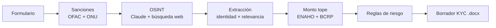

# KYC OSINT

> **Hacemos borradores de KYC para boutiques de wealth management en el Perú mediante un agente que cruza listas de sanciones, fuentes públicas peruanas y un estimador de patrimonio: en un minuto y con cada hallazgo citado.**

Proyecto final de *Data Science con Python* (Universidad del Pacífico, 2026-II) · [issue #205](https://github.com/d2cml-ai/Data-Science-Python/issues/205)

**Demo:** _URL de Streamlit Community Cloud (pendiente)_ · **Video de respaldo:** _pendiente_

---

## 1. One-liner

Hacemos **borradores de KYC** para **boutiques de wealth management en el Perú** mediante **un agente que cruza listas de sanciones, fuentes públicas peruanas y un estimador de patrimonio con la ENAHO**.

## 2. Founder

**Adrián Luyo**, estudiante de la Universidad del Pacífico. Trabajo en wealth management en una boutique de inversiones en Lima. Ahí cada miembro del equipo asume funciones fuera de su puesto: mi compañero de Back Office redacta los KYC de los leads a partir de su propia investigación, una tarea que en rigor es de compliance. Veo el problema todos los días desde el lado comercial: un lead que tarda en pasar KYC es un lead que se enfría.

_TODO (Adrián): ajustar con tu trayectoria y tu rol exacto._

## 3. Problema

**Quién lo sufre.** Boutiques de wealth management, SAF, SAB y family offices en el Perú. Antes de abrir una cuenta deben conocer al cliente: quién es, si es PEP, si figura en listas de sanciones, si tiene noticias adversas y si su patrimonio tiene un origen coherente. En una firma pequeña lo hace alguien de Back Office o de compliance, a mano, googleando.

**Cuánto cuesta.** _TODO con las conversaciones: horas por KYC × KYC al mes × costo por hora; leads perdidos por demora._

**Cómo se resuelve hoy.** Búsquedas manuales en Google, Infogob, El Peruano y medios; listas OFAC y ONU consultadas a mano; el criterio de "¿tiene sentido este patrimonio?" queda en la cabeza de quien revisa. Las bases globales (World-Check de LSEG, Dow Jones Risk & Compliance, ComplyAdvantage) son caras para una boutique y entregan coincidencias sueltas, no un borrador.

**Evidencia:** notas de 3 conversaciones con usuarios potenciales en [`docs/research/`](docs/research/).

## 4. Solución e insight

Escribes el nombre del lead y sus datos declarados. En un minuto sale un **borrador de KYC en Word** con:

- **Listas de sanciones** OFAC SDN y ONU, con coincidencia difusa y umbral visible.
- **Perfil, PEP y noticias adversas** desde fuentes públicas peruanas, cada afirmación con su cita [n].
- **Espectro de evidencia:** cada fuente recibe dos puntajes, *¿es la misma persona?* y *¿pesa para el riesgo?*. Las opiniones en redes y los homónimos no contaminan el análisis, pero quedan registrados.
- **Monto tope plausible:** con cuánto dinero, como máximo, podría venir este cliente según su ocupación, edad y negocio (ENAHO 2024 + Ley MYPE + tipo de cambio del BCRP), comparado con lo que declara.
- **Nivel de riesgo y tipo de debida diligencia** (simplificada, estándar o reforzada) con reglas explícitas.

**Insight.** El cuello de botella del KYC no es encontrar información, sino **separar lo relevante del ruido** y **juzgar si el patrimonio tiene sentido**. Por eso el LLM solo juzga y redacta; los números (monto tope) y la decisión de riesgo los hacen reglas transparentes que un oficial de cumplimiento puede revisar y defender ante el regulador.

## 5. Why now

- **LLMs con búsqueda web y salidas estructuradas.** Hace tres años un modelo no podía buscar en la web, leer 15 fuentes y devolver un JSON validado con puntajes por fuente. Hoy una sola llamada lo hace por centavos.
- **Datos públicos abiertos y con API:** OFAC (Sanctions List Service), la ONU (XML), la API del BCRP y los microdatos de la ENAHO del INEI se descargan en segundos.
- **Costo:** un informe cuesta menos de un dólar en API, frente a horas de un analista.

## 6. Demo

**URL pública:** _pendiente (Streamlit Community Cloud)_.

- **Modo sintético (abierto):** cinco personas ficticias con evidencia ficticia: un creador de contenido que opina de política sin ser PEP, una contadora con un homónimo sentenciado, un ex funcionario regional (PEP), un empresario con investigación fiscal por lavado y una comerciante que declara muy por encima de su tope. Sus resultados están precalculados en [`fixtures/resultados/`](fixtures/resultados/): se muestran al instante y sin costo de API.
- **Modo en vivo (con código de acceso):** busca en fuentes públicas reales. Está protegido para que nadie use la URL pública para perfilar a terceros. En la presentación corre sobre mi propio perfil.
- **Simular otro monto:** después de generar un informe, cambias el monto declarado y se recalculan al instante el monto tope, la coherencia, el riesgo y el tipo de DD. Es Python puro: no vuelve a llamar al modelo ni cuesta API. El texto del borrador conserva el monto original, y una nota lo advierte.

**Correrlo en local**

```bash
git clone https://github.com/luyov-belli/KYC_OSINT.git && cd KYC_OSINT
cp .env.example .env        # completar ANTHROPIC_API_KEY y KYC_ACCESS_CODE
uv sync
uv run streamlit run app.py
```

Pruebas sin API: `uv run pytest`. Evaluación con los sintéticos: `uv run python scripts/eval_synthetic.py` ([resultados](docs/eval_sinteticos.md)).

**Capturas:** _pendiente (3)_.

**Arquitectura:** ver [`docs/architecture.md`](docs/architecture.md).



**Modelos y APIs, y por qué**

| Qué | Para qué | Por qué |
|---|---|---|
| Claude Opus 5.5 (`claude-opus-5-5`), API de Anthropic | Búsqueda, extracción y redacción | Búsqueda web del servidor y salidas estructuradas con una sola key; buen español; razona sobre homónimos |
| Herramientas `web_search` / `web_fetch` del servidor | OSINT | Sin otra key ni scraper propio; respeta los sitios que bloquean bots |
| OFAC SDN + ALT (CSV) y ONU (XML) | Sanciones | Fuentes oficiales y gratuitas |
| ENAHO 2024, módulo 500 (INEI) | Monto tope | Única fuente pública de ingresos por ocupación y edad en el Perú |
| API del BCRP (serie PD04640PD) | Tipo de cambio | Convierte montos en dólares con el dato oficial del día |

## 7. Modelo de negocio

- **Quién paga:** boutiques de wealth management, SAF, SAB y family offices (el área comercial o la de compliance).
- **Precio:** _preliminar, a validar en las conversaciones:_ **S/ 49 por informe**, o **S/ 990 al mes** con 30 informes.
- **Costo por informe (medido con `usage` de la API):**
  - **En vivo:** ~US$ 0.43 (≈ S/ 1.5). Son 5 búsquedas web (US$ 0.05), ~51 mil tokens de entrada y ~9 mil de salida con Claude Opus 5.5. Tarda entre 75 y 95 s.
  - **Sintético:** ~US$ 0.09 por informe al generarlo (sin búsqueda web) y ~25 s ([evaluación](docs/eval_sinteticos.md): 5/5 casos correctos). Mostrarlo desde el resultado guardado: US$ 0.
  - **Simular otro monto:** US$ 0 (reglas en Python).
  - **Servidor:** S/ 0 en Streamlit Community Cloud.
  - **Margen bruto:** con S/ 49 por informe, el costo variable es ~3 % del precio.
- **Qué sigue:** piloto en mi firma, plantilla de KYC de cada cliente, más fuentes peruanas (Poder Judicial, SUNARP con convenio) e historial de monitoreo.

## 8. Herramientas del curso

| Herramienta | Sesión | Dónde | Para qué |
|---|---|---|---|
| Scraping y APIs | 03 | [`kyc/sanctions.py`](kyc/sanctions.py), [`kyc/osint.py`](kyc/osint.py), [`kyc/wealth.py`](kyc/wealth.py) (API BCRP), [`scripts/build_enaho_table.py`](scripts/build_enaho_table.py) | Ingesta de listas oficiales, búsqueda en fuentes públicas, tipo de cambio y microdatos |
| LLMs con salidas estructuradas | 08 | [`kyc/llm.py`](kyc/llm.py), [`kyc/schemas.py`](kyc/schemas.py) | Extraer hallazgos con puntajes en JSON validado por pydantic y redactar con citas |
| Dashboards (Streamlit) | 05 | [`app.py`](app.py) | El producto: formulario, gráfico identidad × relevancia, monto tope y descarga |
| Datos de la ENAHO | 16 | [`data/ingresos_ocupacion_edad.csv`](data/ingresos_ocupacion_edad.csv) | Percentiles de ingreso por ocupación y edad para el monto tope |

**Por qué estas:** las APIs y el scraping traen los datos públicos que exige un KYC, y las salidas estructuradas convierten texto desordenado en evidencia auditable. Streamlit pone todo en una URL que un oficial de cumplimiento puede usar sin instalar nada.

## 9. Qué hizo el agente

Construido con **Claude Code** a lo largo del 15 y 16 de noviembre de 2026.

- **Yo (Adrián):** el problema, los filtros de compliance que aplica una boutique, el criterio de qué es relevante, el umbral de DD por monto, los casos de prueba y la validación con usuarios.
- **Claude Code:** propuso la arquitectura y la priorización; escribió el código de `kyc/`, `app.py`, los scripts, las pruebas, los cinco fixtures sintéticos y el procesamiento de la ENAHO (en una sesión paralela); y redactó el primer borrador de este README.
- _TODO (Adrián): qué revisaste o cambiaste tú._

---

## Riesgos, límites y base legal

- **Asiste, no decide.** El borrador lo revisa y firma un oficial de cumplimiento.
- **Solo fuentes públicas.** Sin logins, sin captchas, sin redes que lo prohíban.
- **Datos personales.** En producción, la base legal sería la obligación de debida diligencia del sujeto obligado y el uso de fuentes de acceso público (Ley 29733; a validar con asesoría legal). Para este curso, el demo en vivo corre solo sobre mi propio perfil, y los demás casos son sintéticos. Los informes en vivo no se guardan.
- **Monto tope.** La ENAHO subestima los ingresos altos: el tope sirve para pedir sustento, no para rechazar.
- **Homónimos.** Con nombres comunes, la calidad depende de los desambiguadores (DNI, edad, ciudad, empleador).
