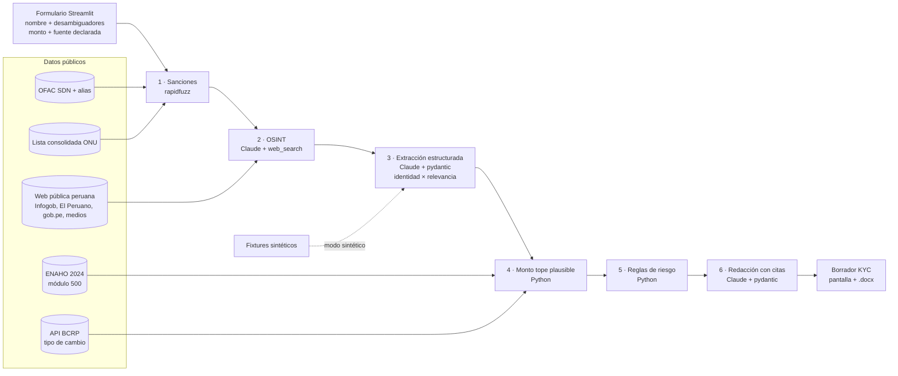

# Arquitectura

| Paso | Archivo | ¿LLM? | Por qué así |
|---|---|---|---|
| Sanciones | `kyc/sanctions.py` | No | Es binario y auditable: listas oficiales y similitud difusa con umbral visible |
| OSINT | `kyc/osint.py` | Sí | Buscar y leer fuentes heterogéneas es justo lo que un LLM con búsqueda hace bien |
| Extracción | `kyc/llm.py`, `kyc/schemas.py` | Sí | Juzgar si una nota habla de la misma persona y si importa requiere criterio; la salida es JSON validado |
| Monto tope | `kyc/wealth.py` | No | Los números no se le piden al LLM: salen de la ENAHO y de supuestos visibles |
| Riesgo | `kyc/risk.py` | No | Reglas explícitas que un oficial de cumplimiento puede revisar y defender ante el regulador |
| Redacción | `kyc/llm.py` | Sí | Convierte hallazgos en prosa de compliance, citando cada fuente |
